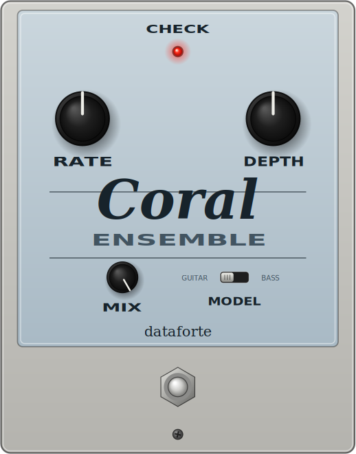

# Coral Ensemble

<p align="center">
  
</p>

Faust-based emulation of the **BOSS CE-2 Chorus Ensemble** (1979) as an
LV2 (with a modgui), VST3 and CLAP plugin and a standalone
JACK app, with a scalable GUI that recalls the original pedal. The 1987
**CE-2B** bass version's component set and its E.LEVEL control are
included as a model; at MIX maximum the two are identical.

The CE-2 is the compact two-knob chorus that defined the lush, warm
chorus sound of the 1980s: a bucket-brigade delay clocked by an
oscillator that a triangle LFO sweeps, mixed with the dry signal and
sandwiched between pre/de-emphasis shelving and steep Sallen-Key
anti-aliasing filters. It is the chorus on countless records — The
Smiths, The Cure, TSOL and the Southern California death-rock scene, and
"pretty much everyone who used chorus during the '80s" (Guitar World).

## Signal path

Modelled on the Boss CE-2 service schematic (Feb 1987) and on the
[Aion FX "Azure" trace](https://aionfx.com/project/azure-analog-chorus/)
of a real CE-2, cross-checked stage by stage against
[ElectroSmash's CE-2 analysis](https://electrosmash.com/boss-ce-2-analysis):

```
in ──► Q1 buffer ──► pre-emphasis ──┬──────────────────────────────┐ (dry)
        (7.2 Hz HP)   (shelf)       │                              │
                                    └► HP 48 Hz ─► AA filter ─► BBD ─► HP 14.6 Hz
                                                  (3rd order)   (4.65 ms, swept)
                                                                    │
                                     ┌──────────────────────────────┘
                                     └► reconstruction ──► de-emphasis + mix ──► HP 1.6 Hz ──► out
                                        (3rd order)        (R21/R22 47k, shelf)
```

- **Input buffer (Q1)**: emitter follower, 1k + 470k bias through C1 47n
  (7.2 Hz highpass), 407k input impedance (ElectroSmash). C2 470n into
  the next stage (another 7.2 Hz corner).
- **Pre-emphasis (IC1B)**: inverting shelving — R4 47k in parallel with
  C3 6n8 + R5 10k into the virtual ground, R6 47k || C4 100p in the
  feedback. Gain −1 below 410 Hz rising to about **+14.5 dB at 10 kHz**
  (the 100p cap rolls it back above ~10 kHz). It improves the BBD's
  signal-to-noise ratio; the de-emphasis undoes it.
- **Anti-aliasing filter**: C8 33n + R13 100k (48 Hz highpass) into a
  3rd-order Sallen-Key low-pass with a Q2 emitter follower as the buffer
  (R14/R15/R16 10k, C9 3n3, C10 8n2 bootstrapped to the emitter,
  C11 470p). −6 dB at 6.6 kHz, steeper above; this keeps the clocked
  bucket brigade from aliasing.
- **BBD**: MN3007, 1024 stages, clocked by an MN3101. Delay = 1024/(2·f).
  Measured on a real CE-2 at the MN3007 clock pins: **110 kHz with DEPTH
  at 0** (the sweep centre) and **100–128 kHz with DEPTH at noon**, i.e.
  a centre delay of **4.65 ms** and a sweep of about ±24.6 % at full
  depth (3.7–6.2 ms). A soft bucket-swing limit is modelled at the BBD
  input.
- **Reconstruction filter**: the mirror of the anti-aliasing stage
  (same 10k/3n3/8n2/470p values, Q3 follower), preceded by the wet-path
  highpass — C14 33n with R15 330k = **14.6 Hz**, or **12n = 40 Hz** in
  the CE-2B (Aion: "the only component difference … C17 33n → 12n").
- **De-emphasis and mix (IC1A)**: inverting summing amp with R21 47k
  (dry) and R22 47k (wet) into the virtual ground and R24 47k ||
  (R23 10k + C15 6n8) || C16 100p in the feedback: gain −1 per input at
  low frequencies, **−15 dB above 2.34 kHz**. Because the dry path also
  runs through the pre-emphasis, the dry response stays flat (the
  measured pre·de-emphasis product is within 0.1 dB up to 6.6 kHz); the
  shelf mostly shapes the BBD's noise.
- **Output**: C7 1uF + R12 100k (1.6 Hz highpass).
- **LFO**: TL022 Schmitt trigger (R30 47k hysteresis, R29 33k from the
  integrator output) and integrator (R32 1M, C19 0.1u) — the Mancini
  triangle oscillator. RATE (100kB) is a divider on the square wave
  driving the integrator, so the frequency is linear in pot travel;
  DEPTH (100kB) divides the triangle; R34 220k + C20 10n is a 72 Hz
  lowpass into the Q5 buffer. **Measured: 3.5 Hz at maximum, 0.3 Hz at
  minimum** (anasounds oscilloscope measurements of a CE-2); the circuit
  formula R30/(4·R29·R32·C19) gives 3.5 Hz for the maximum, confirming
  the component values.
- **Clock VCO**: the LFO voltage sets the charging current of C18 47pF
  through R29 150k (Q4/Q5, D2/D3), so the clock — and therefore the
  delay — follows the triangle.

## Controls

All controls are pot positions, **0–10 = fraction of travel clockwise**,
as on the pedal (7 o'clock … 5 o'clock, noon = 5), so published
clock-face settings map directly.

| Port | Symbol | Range | Default | Meaning |
|---|---|---|---|---|
| RATE  | `rate`  | 0–10 | 5 | LFO speed, 0.3 Hz (0) to 3.5 Hz (10) |
| DEPTH | `depth` | 0–10 | 5 | sweep depth: 0 = static 4.65 ms, 10 = 3.7–6.2 ms |
| MIX   | `mix`   | 0–10 | 10 | wet level: 10 = the stock CE-2 mix (dry and wet at unity) |
| MODEL | `model` | Guitar / Bass | Guitar | CE-2 (wet highpass 14.6 Hz) or CE-2B (40 Hz) |
| —     | `lv2_enabled` | 0/1 | — | bypass (10 ms click-free crossfade to exact dry) |

Modelling notes and deliberate deviations:

- **Rate law**: the oscillator's frequency is proportional to the RATE
  pot position; the model maps 0–10 onto the measured 0.3–3.5 Hz range
  (linear in travel, matching the 100kB pot). Fully counter-clockwise a
  real unit is at the very edge of its range; the measured minimum is
  used instead of a frozen LFO.
- **Full-depth clock swing**: derived from the measured mid-depth sweep
  (100–128 kHz, i.e. ±12.3 % at DEPTH 5) and the linear depth divider —
  an extrapolation, not a direct measurement. It puts the maximum sweep
  at 3.7–6.2 ms, consistent with the MN3007's 1024 stages and the
  measured centre.
- **BBD**: modelled as a fractional delay (4-point Hermite interpolation)
  with a soft input limit. The clocked sample-and-hold is not
  reproduced: the anti-aliasing filter cuts at 6.6 kHz, far below the
  clock Nyquist, so this is inaudible in the band. The bucket-swing limit
  (±2.5 V) is an estimate (the MN3007 is specified for 0.5 % THD at
  0.78 Vrms; the buckets swing to roughly a third of the 9 V supply).
  BBD hiss is not modelled.
- **MIX taper**: the CE-2B's E.LEVEL is a 250kC (reverse-log) pot; the
  model uses a linear wet level so automation is predictable. MIX at 10
  is exactly the stock CE-2 mix.
- **Level**: the circuit sums dry and wet at unity each (three equal 47k
  resistors), so the engaged pedal is a few dB louder on average and its
  low end is combed — the first notch sits at about 123 Hz (4.65 ms plus
  the +27° the wet-path highpasses add), which is what the model does.
- **Bypass**: the original JFET switch is replaced by the host bypass
  (exact dry while bypassed, 10 ms crossfade).

## Presets

| Preset | RATE | DEPTH | MIX | MODEL | Source |
|---|---|---|---|---|---|
| CE-2 noon — classic 80s clean chorus | 5 | 5 | 10 | Guitar | plugin default (the classic setting) |
| Smiths clean shimmer (Marr-style) | 3.5 | 6.5 | 10 | Guitar | fan recreations of the Smiths chorus: "Rate 10–11 o'clock, Depth 1–2 o'clock" (guitargangsters) and "rate ~10 o'clock, depth ~2 o'clock" (community). A recreation, **not** Johnny Marr's published settings |
| TSOL / SoCal death rock | 2.0 | 4.8 | 10 | Guitar | BOSS article: "Rate set to a crawl at 9 o'clock and the Depth just shy of noon" |
| Max warp (both knobs full) | 10 | 10 | 10 | Guitar | Guitar World: "even with the Rate and Depth knobs fully maxed, it produces a gently warbling vibrato" |
| Bass: low end preserved (CE-2B) | 3 | 5 | 6.5 | Bass | illustrative setting for the CE-2B, whose mix control Aion describes as "especially useful for bass guitar so the low-end is preserved" |

No artist or song is credited with settings that its source does not
state; the Smiths preset is the recreation's numbers, not the artist's.

The preset list is data: `presets/coralensemble.json` is the source of
truth (names, values, source metadata). `make presets` regenerates the
checked-in `plugins/CoralEnsemble/Presets.hpp`; the DPF wrapper exposes
those entries as programs, which DPF exports to LV2 `manifest.ttl`/
`presets.ttl` and to VST3/CLAP. Adding or editing a preset means editing
the JSON and running `make presets` -- no C++ changes.

## GUI

The pedal is drawn with cairo in a fixed design space (285 × 440) and
scaled to the window with the aspect ratio kept, from 0.5× up, HiDPI
aware. Knobs drag (Shift: fine), respond to the wheel and reset on
double-click; the switch and the footswitch click. The palette and
layout recall the CE-2: grey die-cast enclosure, pale-blue label, CHECK
lamp, the model name in flowing lettering, the CE-2B's third knob and a
GUITAR/BASS slide switch. The **dataforte** wordmark is set in
[Bitcount Grid Double](https://fonts.google.com/specimen/Bitcount+Grid+Double)
(SIL Open Font License 1.1); its outline is baked into
`plugins/CoralEnsemble/BrandPath.hpp` by `tools/gen_brand.py`, so the UI
and the modgui render it identically without the font installed.

The modgui is generated from the same artwork
(`tools/render_modgui.cpp`): film strips for the knobs (61 frames), the
switch and LED, plus `icon.html`, `stylesheet.css` and `modgui.ttl`, with
every control snapped to whole CSS pixels.

The Linux UI is `ui:X11UI`; on Wayland it runs through XWayland (LV2 has
no Wayland UI type).

House rule: **pedal-face UIs use cairo** (CPU raster, no OpenGL), so the desktop UI, the modgui and the screenshots come from the same drawing code.

## Building

```sh
git submodule update --init --recursive   # DPF
make                                      # LV2 + VST3 + CLAP + JACK into bin/
make NOUI=true                            # DSP only (build hosts)
make install INSTALL_DIR=~/.lv2
make install-all INSTALL_DIR=~/.lv2 VST3_DIR=~/.vst3 CLAP_DIR=~/.clap BIN_DIR=~/.local/bin
```

The DSP is Faust (`src/coralensemble.dsp`); the linear stages come from
`src/coralensemble_tf.lib`, generated by symbolic nodal analysis
(`tools/gen_tf.py`, needs sympy). `src/coralensemble.cc` is the
dsp2cc-generated C++ (needs faust and the Guitarix `dsp2cc` tool,
`make dsp`), and `plugins/CoralEnsemble/BrandPath.hpp` is the baked
wordmark outline (`make brand`, needs fontTools). All generated files are
checked in, so a normal build needs none of those tools.

Tests: `make test` (DSP behaviour: comb and delay laws, depth, rate,
model, mix, bypass, silence, random-control stress, 44.1–192 kHz),
`make test-clap`, `make test-ui` (real UI under Xvfb/XTest),
`make test-modgui` (headless Chrome against the cairo artwork);
`make test-all` runs everything.

Measurements on this machine (x86-64, 48 kHz): 0.1 % of one core for the
DSP, in the same class as the other Dataforte modulation plugins (well
under 1 % on a Pi 4).

## Layout

```
src/coralensemble.dsp        Faust DSP (authoritative)
src/coralensemble_tf.lib     generated linear stages (tools/gen_tf.py)
src/coralensemble.cc/.h      dsp2cc-generated class + port enum
src/ce_glue.h                Guitarix-style PluginLV2 glue
plugins/CoralEnsemble/       DPF plugin, UI and Artwork.hpp (shared cairo art)
plugins/CoralEnsemble/BrandPath.hpp   baked "dataforte" wordmark outline
plugins/CoralEnsemble/fonts/  Bitcount Grid Double + its OFL license
tools/render_modgui.cpp      modgui + screenshot renderer
tools/gen_brand.py           bakes the wordmark from the font
modgui/                      generated modgui (checked in)
tests/                       DSP, CLAP, UI and modgui harnesses
```

Identifiers: LV2 `http://dataforte.net/plugins/coralensemble`, CLAP
`net.dataforte.coralensemble`, bundle `coralensemble.lv2`, brand
Dataforte.

## Sources

- Boss **CE-2 / CE-2B service manual** (Feb 1987) and CE-2 owner's
  manual — schematic, parts and specifications (synthxl.com archive).
- **Aion FX "Azure Analog Chorus"** project and build documentation
  (rev 1.1.3) — trace of a real CE-2 with the complete component set,
  the CE-2B difference and the bass mod notes:
  <https://aionfx.com/project/azure-analog-chorus/>.
- **ElectroSmash, "Boss CE-2 Analysis"** — stage-by-stage circuit
  analysis (input impedance, shelving and Sallen-Key formulas, LFO
  topology and the 3.5 Hz formula).
- **anasounds, "the analog chorus … working and study of the boss ce-2"**
  — oscilloscope measurements of the LFO (3.5 Hz both pots up, depth
  changes amplitude only, rate down to ~0.3 Hz).
- **diystompboxes.com**, "BOSS CE-2: clock frequencies (and maybe more)"
  — measured MN3007 clock: 110 kHz at DEPTH 0, 100–128 kHz at mid depth.
- **BOSS articles, "A Chorus of Tones: CE-2W Studio Applications"** — the
  9 o'clock / near-noon setting, and the pedal's blue look.
- **Guitar World**, "How a little dual-knob blue chorus pedal from Boss
  took over the world" — the fully-maxed description.
- Version history (black label MIJ 1979–84, green label MIJ 1984–88,
  Taiwan 1988–91): ElectroSmash and community reports agree that the
  three are circuit-identical apart from labels and the power-supply
  revision, so no variant selector is offered for them.

## License

GPL-2.0-or-later. BOSS and CE-2 are trademarks of Roland Corporation;
this is an independent emulation, not endorsed by or affiliated with
Roland.
